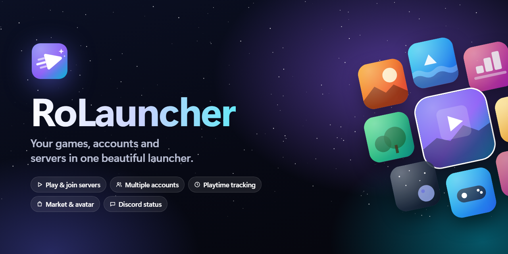

<div align="center">



<br />


# RoLauncher

**A sleek, unofficial launcher for Roblox on Windows.**<br />
Two interfaces, multiple accounts, an avatar editor, server browser, Discord presence — and your games, right inside one window.

<br />

[](https://github.com/rawified/RoLauncher/releases/latest)
&nbsp;

&nbsp;

&nbsp;


[**Download**](https://github.com/rawified/RoLauncher/releases/latest) · [Features](#-features) · [Install](#-install) · [Build it yourself](#-build-it-yourself) · [Made with AI](#-made-with-ai)

</div>

---

## ✨ Features

<table>
<tr>
<td width="50%" valign="top">

### 🎮 Play
- **Sign in with your real Roblox account** and launch any experience in one click
- **Play inside the launcher** — Roblox sits in RoLauncher's window, with full mouse and keyboard input
- **Auto-return**: leave a game and RoLauncher closes Roblox and comes back
- **Multiple Roblox windows** at the same time
- **Per-game playtime** with a 7-day history
- **Minimize a game** to use the launcher while you play, then hit **Continue playing**
- Asks what to do with running games when you close the launcher

</td>
<td width="50%" valign="top">

### 👥 Accounts & people
- **Alt account switcher** — sign-ins are encrypted with Windows (DPAPI) and never leave your PC
- **"Play as"** any saved account
- **Profile viewer**: avatar, **RAP**, what they're **currently wearing**, limiteds, friends, groups, badges, favorites
- **Trading**: see inbound, outbound and past trades, accept, decline or counter, and send new trades with RAP totals
- **Friends** list with who's online and in-game

</td>
</tr>
<tr>
<td valign="top">

### 🌐 Servers & news
- **Server browser** — scroll, expand, sort and join public servers
- **Private servers**: list, join, join by link, create and manage
- **Game news** from experience events and updates, in a glassy pop-up

</td>
<td valign="top">

### 👕 Avatar & market
- **Avatar editor with a live preview** — see changes before you save
- **Body parts, bodies, animation packs**, per-part skin colors and **body scaling**
- **Outfits**: try on, save, update, rename and delete — synced to Roblox
- **Market** with item pop-ups and buying right in the launcher

</td>
</tr>
<tr>
<td valign="top">

### 🖥️ Two interfaces
- **Classic** — a clean desktop launcher layout
- **Console** — a living-room style home screen with big tiles, a dynamic background and keyboard navigation
- Switch any time in **Settings → Interface**

</td>
<td valign="top">

### 🔧 Extras
- **Discord Rich Presence** — shows what you're playing, with *View game* and *Join server* buttons
- **Update notifications**: asks when a new version is out, and updates in one click
- Per-user **installer & uninstaller** — no admin rights needed
- Accent colors, animated starfield and more

</td>
</tr>
</table>

---

## 📥 Install

1. Grab **`RoLauncherSetup-x.y.z.exe`** from the [latest release](https://github.com/rawified/RoLauncher/releases/latest).
2. Run it and press **Install** — it installs for your Windows user only, no admin needed.
3. Open RoLauncher from the Start menu, go to **Settings** and sign in with Roblox.

> [!NOTE]
> Windows SmartScreen may warn about an unknown publisher because the installer isn't code-signed. Choose **More info → Run anyway** if you trust this release.

**Requirements:** Windows 10 or 11 (64-bit), the Roblox Player, and the [Microsoft Edge WebView2 Runtime](https://developer.microsoft.com/microsoft-edge/webview2/) (already on most PCs — the installer tells you if it's missing).

**Updating:** RoLauncher checks GitHub for new versions and asks you when one is out (never in the middle of a game; you can turn this off in Settings → Updates). Press **Update now** and it downloads the new installer from this repository's releases, updates itself and reopens — your sign-ins and settings stay.

**Uninstalling:** Windows Settings → Apps → Installed apps → RoLauncher → Uninstall. You'll be asked whether to keep your data.

---

## 🛠️ Build it yourself

You need the [.NET 10 SDK](https://dotnet.microsoft.com/download) on Windows.

```powershell
git clone https://github.com/rawified/RoLauncher.git
cd RoLauncher
dotnet run                                   # run the launcher
.\build-installer.ps1 -Version 1.3.1         # build dist\RoLauncherSetup-1.3.1.exe
```

### Publishing an update

1. Bump `<Version>` in `RoLauncher.csproj` and `installer/Setup.csproj`.
2. Run `.\build-installer.ps1 -Version <version>`.
3. Create a GitHub release tagged **`v<version>`** and attach `dist\RoLauncherSetup-<version>.exe`.

Every RoLauncher with auto-updates on will offer the new version on its next start.

### How it's put together

| Part | What it does |
|---|---|
| `MainForm.cs` | Borderless WinForms window hosting the UI in **WebView2**; the bridge between the page and Windows |
| `RobloxClient.cs` | Proxy for Roblox web APIs (only `*.roblox.com`), handles the CSRF token and the signed-in account |
| `AccountStore.cs` | Saved accounts, encrypted with Windows DPAPI |
| `GameSession.cs` | Finds the Roblox window and follows its log to know when you join or leave a game |
| `DiscordRpc.cs` | Discord Rich Presence over Discord's local IPC pipe |
| `Updater.cs` | Checks GitHub Releases and installs updates |
| `Uninstaller.cs` / `installer/` | The installer, update mode and uninstaller |
| `wwwroot/` | The whole interface — HTML, CSS and JavaScript (`index.html` Classic, `console.html` Console) |

---

## 🤖 Made with AI

**RoLauncher was created with the help of AI.** The code, interface, logo and this README were built by me ([@rawified](https://github.com/rawified)) together with **Claude**, Anthropic's AI assistant, using **Claude Code**. I came up with the ideas, tested everything and decided what goes in; the AI wrote most of the code.

---

## ⚖️ Disclaimer

RoLauncher is an independent fan project and is **not affiliated with, endorsed by, or connected to Roblox Corporation**. "Roblox" is a trademark of Roblox Corporation. RoLauncher uses Roblox's public web APIs with your own account and launches the official Roblox Player — use it at your own risk and follow the [Roblox Terms of Use](https://en.help.roblox.com/hc/articles/115004647846).

Your Roblox sign-in is stored only on your PC, encrypted for your Windows user, and is only ever sent to `roblox.com`.

<div align="center">
<br />
<sub>Made with ❤️ and a lot of AI by <a href="https://github.com/rawified">rawified</a></sub>
</div>
